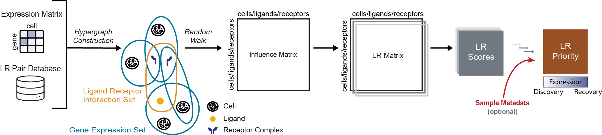

# HyperCom

HyperCom is the R package implementation of the method described in [HyperCom: a hypergraph-based method to infer cell-resolved cell-cell communication](https://www.biorxiv.org/content/10.64898/2026.09.30.755742v1) on bioRxiv. It is a hypergraph-based method to understand cell-cell communication at a cluster-free single-cell resolution.

HyperCom provides the following hypergraph-based features described in the [overview vignette](vignettes/articles/HyperCom_Overview.qmd):

1. Per Cell Ligand-Receptor Pair Scoring

2. Per Dataset Ligand-Receptor Pair Prioritization

## Installation
HyperCom needs R 4.1 or newer. It contains C++ code, so installing it from GitHub compiles that code, which needs build tools.
Set them up once for your system:

- **Windows:** install [Rtools](https://cran.r-project.org/bin/windows/Rtools/) for your version of R (e.g. Rtools 4.4 for R 4.4).
- **macOS:** run `xcode-select --install` in the Terminal, then install GNU Fortran for your version of R from
  [mac.r-project.org/tools](https://mac.r-project.org/tools/).
- **Linux:** install R's development package (Ubuntu/Debian: `sudo apt install r-base-dev`).

Then, in R:
```r
install.packages("pak")
pak::pak("pawelab/HyperCom")
```

`HyperCom_seurat` also needs the SeuratObject package (`install.packages("SeuratObject")`).

## Usage
Counts are a gene x cell matrix (raw or normalised, not scaled) and the metadata has one row per cell, named by its barcode:
```r
library(HyperCom)
res <- HyperCom(cellchat.mm.lrdb, alexanian2021.counts, alexanian2021.metadata, sample="sample", group="condition", parallel=TRUE)
head(res$priority[["1"]])
scores <- score_hypercom(res$infMat, res$metadata, ligand="Thbs1", receptors="Sdc4")
```
Every step is also written to `outdir` (default `HyperCom/`). See `?HyperCom` and the vignette; cite with `citation("HyperCom")`.

## Method Overview

