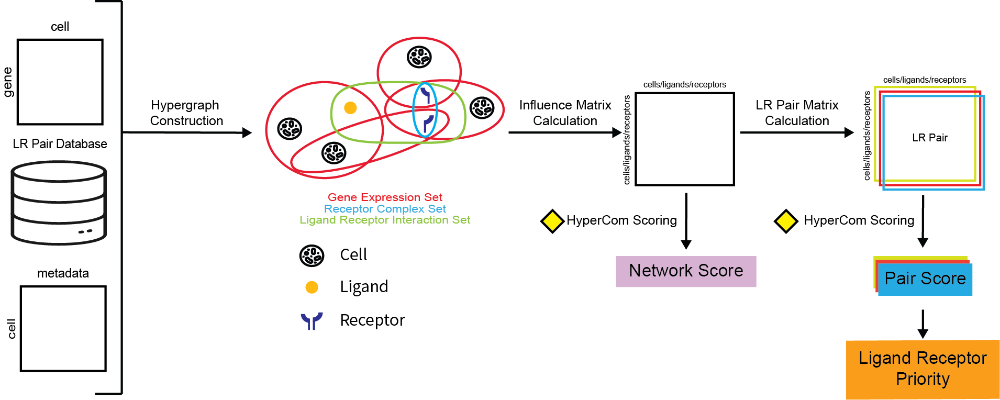

# HyperCom

HyperCom is the R package implementation of the method described in [Moy and Przytycki, 202X](https://doi.org). It is a hypergraph based method to understand cell-cell communication at a cluster free single-cell resolution.

HyperCom provides the following hypergraph based features described in the [overview vignette](vignettes/articles/HyperCom_Overview.pdf):

1. Per Cell Ligand-Receptor Pair Scoring

2. Per Dataset Ligand-Receptor Pair Prioritization

## Installation
```r
devtools::install_github("pawelab/HyperCom")
```

## Method Overview


---

## Branch `v1-fast` (version 0.1.0)

This branch is the same package and method with the same outputs, computed faster and in less
memory. It installs as `HyperCom` and replaces the release; to compare the two side by side,
install one of them under another name.

```r
devtools::install_github("pawelab/HyperCom", ref = "v1-fast")
library(HyperCom)
```

### What changed

| | Release (0.0.0.9000) | v1-fast (0.1.0) |
|---|---|---|
| Influence matrix | dense LU via `solve()` on whatever BLAS R links; ~6 dense L×L copies | Cholesky of the symmetrised matrix (`method = "chol"`, the default for a symmetric adjacency; `"lu"` reproduces the release), ~2 copies, BLAS threads set at run time |
| Per-LR scoring | the cell×cell grid, its ranks and a same-sample mask built as dense n×n matrices, once per receptor subunit; PSOCK cluster that copies the influence matrix to every worker | one C++ kernel (`src/rank_grid.cpp`) computes the grid on the fly, ranks it by histogram + chunked counting sort with exact integer rank sums, and reads the influence matrix in place; each unique (ligand, subunit) grid is scored once; OpenMP threads within a grid (memory independent of the core count), or forked workers |
| Results | | bit-identical LR priorities (5k: all 914 pairs; 20k: the tested subset) |

Measured on the SCC (Xeon E5-2660 v3, 8 cores), Xenium ovarian data:

| | 5k cells (914 pairs) | 20k cells (918 pairs) |
|---|---|---|
| influence matrix | 410 s → 1–2 s | ~6–7 h → 52 s |
| LR scoring, all pairs | 814 s → 241 s | out of memory → 1.8 h |
| peak memory of the scoring | 22 GB → 1 GB | — → 11 GB |

### Use

```r
# Start R with FLEXIBLAS=MklOpenMP on the SCC (or any optimised BLAS elsewhere): the NETLIB
# reference BLAS that R links by default is single-threaded and ~16x slower for the inversion.
# How to check which BLAS you have, install one, and choose it: see BLAS.md.
infMat   <- generate_infMat(adj, method = "chol", threads = 8)
priority <- prioritize_lr(lrs, adj, infMat, metadata, cores = 8, workers = 1, grid.mem.gb = 8)
# whole pipeline
HyperCom(lrdb, counts, metadata, sample = "sample", coords = coords,
         infmat.method = "chol", cores = 8, workers = 1, grid.mem.gb = 8)
```

New arguments (all optional; old calls run unchanged):

- `generate_infMat(method = c("auto", "chol", "lu"), threads)`.
- `prioritize_lr(..., cores, workers = 1, grid.mem.gb = 1)`: `cores` total cores; `workers = 1`
  scores one grid at a time on `cores` threads; `workers = k` scores k grids at once on one thread
  each (k × `grid.mem.gb` memory). `grid.mem.gb` is the sort-space budget per grid: 16·n² bytes
  holds a whole grid in one pass (0.35 GB at 5k cells, 6.3 GB at 20k); a smaller budget means more
  passes over the influence matrix, never different numbers.
- `HyperCom(..., infmat.method, cores, workers, grid.mem.gb)` forwards the above.
- `generate_cell_info()` and `score_spatial_decay()` are exported.

Rules of thumb: time ≈ 1.8 h × (n / 20k)² on 8 cores for the scoring, memory ≈ 8·L² + `grid.mem.gb`
(L = cells + genes). Everything in `R/functions.R` that changed carries a `FLAG:MODIFIED_20261025`
or `FLAG:NEW_20261025` comment block explaining why.
